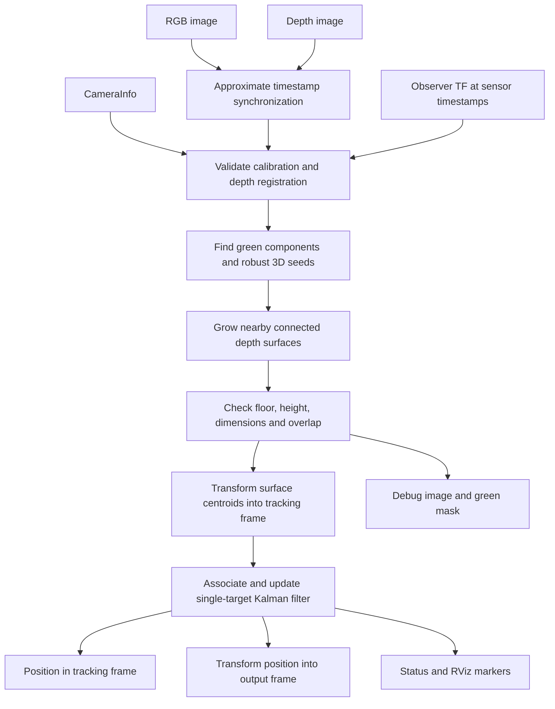

# Current RGB-D Robot Tracking Implementation

Prepared on 2026-10-31 from the source files in this workspace. This document is a standalone technical handoff that can be shared with ChatGPT or another developer. It describes the current implementation, its defaults, and its practical limits.

> This handoff describes the original green-seed implementation before the geometry
> extension. The default green-seed behaviour remains available. For the added
> depth-only `geometry` method, selection/configuration precedence, and current
> verification results, see [the operating guide](robot_tracking.md).

## 1. What the system implements

The `edgeai_robot_tracking` ROS 2 package lets one robot observe a robot-like object using its RGB-D camera, detect plausible visible surfaces starting from green wheel pixels, and maintain one filtered 3D surface-position estimate over time.

The default experiment uses `robot1` as the observer and suggests keyboard control of `robot2`. The perception node uses the observer's RGB image, depth image, camera calibration, and timestamped TF transforms. It does not subscribe to the target robot's pose, odometry, identity, or simulator ground truth. `target_ns` only changes the keyboard command printed by the launcher; it does not tell the detector which object to track.

This is a classical colour/depth pipeline implemented with OpenCV and NumPy, followed by a constant-velocity Kalman filter. There is no trained object detector, neural network, fiducial marker detector, or semantic segmentation model.

The main output is the **centroid of the detected visible surface**, filtered over time. It is not an estimate of the target's chassis centre, base frame, orientation, or full pose. A single visible wheel can provide a valid partial observation.

The package also provides a separate terminal keyboard controller. Perception does not command the observer to follow the target; no following controller or autonomous navigation behaviour is implemented in this package.

## 2. Source layout and responsibilities

Paths in this document are relative to the workspace root.

| File | Responsibility |
| --- | --- |
| `src/edgeai_robot_tracking/edgeai_robot_tracking/camera.py` | Depth units, calibration validation, pixel/3D conversion, rigid transforms, depth-to-RGB registration |
| `src/edgeai_robot_tracking/edgeai_robot_tracking/detection.py` | Green seed extraction, robust seed depth, depth-connected surface growth, geometry checks, duplicate suppression |
| `src/edgeai_robot_tracking/edgeai_robot_tracking/tracking.py` | Single-target constant-velocity Kalman filter, association, confirmation, prediction, expiry |
| `src/edgeai_robot_tracking/edgeai_robot_tracking/detector_node.py` | ROS subscriptions, synchronization, TF lookup, processing timer, output topics, diagnostics, debug images, RViz markers |
| `src/edgeai_robot_tracking/edgeai_robot_tracking/teleop.py` | Interactive keyboard input and velocity-command watchdog |
| `src/edgeai_robot_tracking/config/tracking.yaml` | Default processing, detection, and tracking settings |
| `src/edgeai_robot_tracking/launch/detection_tracking.launch.py` | Optional simulation startup, observer namespace, frame configuration, perception node |
| `src/edgeai_robot_tracking/setup.py` | Package installation and `rgbd_tracker` / `keyboard_teleop` executables |
| `src/edgeai_robot_tracking/test/` | Unit tests and opt-in ROS/terminal integration tests |
| `src/edgeai_robot_description/launch/multi_robot_sim.launch.py` | Existing multi-robot simulation, bridges, TF, and RViz setup used by the experiment |
| `src/edgeai_robot_description/urdf/edgeai_robot_real.urdf.xacro` | Robot geometry, wheel colours, camera mounting, and simulated RGB-D sensor |
| `docs/robot_tracking.md` | Existing operating guide and manual validation procedure |

The package is an `ament_python` package, version `0.1.0`. The workspace uses ROS 2 Jazzy and Gazebo Harmonic through Pixi. Relevant dependencies include `rclpy`, `cv_bridge`, `message_filters`, TF2, OpenCV, NumPy, and ROS image, geometry, diagnostic, and visualization messages.

## 3. Overall data flow



Two timing mechanisms are used: a steady-clock timer schedules processing even when simulation time is paused, while the ROS clock and message timestamps define tracking time. Keyboard input expiry uses wall time independently.

## 4. Inputs and coordinate frames

### 4.1 Default ROS inputs

With `observer_ns:=robot1`:

| Input | Default topic/frame | Use |
| --- | --- | --- |
| Colour image | `/robot1/camera/image` | Converted to BGR8 for OpenCV |
| Depth image | `/robot1/camera/depth_image` | Converted to metres and aligned with RGB pixels |
| RGB calibration | `/robot1/camera/camera_info` | Image size, intrinsic matrix K, distortion D |
| Depth calibration | `/robot1/camera/camera_info` | Same calibration by default for registered simulation depth |
| Dynamic and fixed transforms | `/tf`, `/tf_static` | Camera mounting and observer movement |
| Simulation clock | `/clock`, when `use_sim_time=true` | ROS time |

RGB and depth subscribers use sensor-data QoS. `CameraInfo` messages are cached separately. Their subscriptions use queue depth 10 with the normal publisher/subscriber defaults; a real camera's calibration publisher must have compatible QoS.

### 4.2 Default frames

| Parameter | Default for robot1 | Meaning |
| --- | --- | --- |
| `base_frame` | `robot1/base_footprint` | Observer floor reference; detector geometry is evaluated here |
| `camera_optical_frame` | `robot1/camera_optical_frame` | RGB optical rays: x right, y down, z forward |
| `depth_optical_frame` | `robot1/camera_optical_frame` | Depth optical rays; same frame for registered simulation depth |
| `tracking_frame` | `robot1/odom` | Continuous frame used by the Kalman filter |
| `output_frame` | `robot1/base_footprint` | Frame used for the relative-position output |

Observer base axes are x forward, y left, and z up. The odometry frame is a local reference maintained by the observer's odometry; its accuracy depends on that odometry.

The node obtains transforms at the relevant timestamps. It does not substitute the latest available transform when a timestamped lookup fails. Identical source and target frames use an identity matrix.

### 4.3 Gazebo image-header adaptation

The model defines a correctly rotated ROS optical frame. Its `<optical_frame_id>` is currently placed directly under `<sensor>` in the Xacro. The existing experiment guide records Gazebo image/calibration headers such as `robot1/base_footprint/rgbd_camera`.

The node explicitly accepts either the configured expected header or the configured optical frame. For the simulation, `expected_rgb_frame` and `expected_depth_frame` default to that scoped Gazebo header. It reconstructs image rays in `camera_optical_frame` / `depth_optical_frame`; it does not infer optical axes from the scoped header name.

The separate TF connection used by the simulation for Gazebo sensor point clouds is not the image reconstruction path. This tracker does not subscribe to `/robot1/camera/points`.

### 4.4 Sensor mounting and floor assumptions

The current model's camera is 0.175 m forward of `base_link` and 0.051 m above it. `base_link` is 0.049 m above `base_footprint`, placing the camera approximately 0.10 m above the reference floor.

The sensor is configured for 640 × 480 images at 30 Hz, a horizontal field of view of 1.047 radians, and a clipping range of 0.10–10 m. The tracker reads actual intrinsics from `CameraInfo` rather than calculating them from field of view.

The floor is modelled as a constant z height in observer base coordinates, default zero. The observer's vertical axis must remain within 15 degrees of the tracking frame's vertical axis. Larger tilt rejects processing. This is a flat-floor model, not an estimated ground plane.

## 5. Synchronization, validation, and depth preparation

### 5.1 Message scheduling

`ApproximateTimeSynchronizer` pairs RGB and depth using a default 25 ms tolerance and queue length 10. Only the newest pending pair is retained. A steady-clock timer processes work at a configured rate of 10 Hz; actual throughput also depends on processing cost and input availability.

At each timer callback, the node:

1. Checks for a backward ROS-clock jump and resets the tracker, pending pair, publication timestamps, and synchronization queues if necessary.
2. Rejects a pending RGB frame older than 0.5 ROS seconds or more than the synchronization tolerance into the future.
3. Drops frames whose RGB timestamp is not newer than the last processed frame.
4. Attempts calibration, timestamped TF lookup, detection, and tracking.
5. Retains a pair when required TF is temporarily unavailable, bounded by the image-age check on later callbacks.
6. Drops a pair on validation or image-conversion errors and reports the problem through diagnostics.
7. Publishes a prediction/status update when no new frame is successfully processed.

The node uses a normal single-threaded spin. TF is retried without a blocking wait, but detection itself runs synchronously in the timer callback.

### 5.2 Calibration checks

The image header must match its expected header or optical frame. Calibration dimensions must match the corresponding image. Intrinsics and distortion coefficients must be finite, focal lengths positive, and the intrinsic matrix must have the supported pinhole structure.

Accepted distortion-model names are empty, `plumb_bob`, and `rational_polynomial`; supported coefficient counts are checked. Nonzero distortion is handled with OpenCV projection/undistortion functions. Binning greater than one, nonzero ROI offsets, or ROI sizes inconsistent with the supplied image are rejected.

Nonzero-stamped calibration must be within 2 seconds of the image timestamp. Zero-stamped calibration is allowed as static information. This is an image-to-calibration timestamp check, not a wall-time cache eviction policy.

### 5.3 Depth units and unprojection

Supported depth encodings:

| Encoding | Conversion |
| --- | --- |
| `32FC1` | Already metres |
| `16UC1` | Multiply by `uint16_depth_scale`, default 0.001 m/unit |

The default accepted range is 0.10–9.5 m. Nonfinite and out-of-range values become NaN. Zero and negative values are therefore invalid under these defaults. Unsupported encodings or non-single-channel arrays raise validation errors.

For an undistorted pixel `(u, v)` with forward-axis depth `d`:

```text
X = (u - cx) * d / fx
Y = (v - cy) * d / fy
Z = d
```

These are optical-frame coordinates. Rigid transforms then convert them to observer base or tracking coordinates.

### 5.4 Registered and unregistered depth

With `depth_registered=true`, the node expects RGB and depth to share a pixel grid. It checks image dimensions, K/D values, image-header agreement, and configured optical-frame agreement. Registration remains an explicit source contract: these checks cannot prove that an external camera has actually aligned its streams.

With `depth_registered=false`, the node:

1. Unprojects valid depth pixels with depth-camera calibration.
2. Looks up the transform from the depth optical frame at the depth timestamp to the RGB optical frame at the RGB timestamp, using `tracking_frame` as the fixed frame.
3. Transforms and projects the points into the RGB grid.
4. Rounds to destination pixels and keeps the nearest positive RGB-frame depth with a z-buffer.
5. Leaves holes as NaN.

It does not fill occlusion holes or resize one image to pretend it is registered. Timestamped observer transforms compensate observer motion; they cannot correct independent target motion between two capture times.

## 6. Detection algorithm

The main function is `detect(...)` in `detection.py`. It returns a candidate list, the full-resolution green mask, and rejection counts.

### 6.1 Green seed extraction

The BGR image is converted to HSV and thresholded between `[35, 65, 35]` and `[90, 255, 255]`. These use OpenCV's hue scale of 0–179. The bounds target the model's green wheels.

Optional morphological opening runs only when `morphology_size > 1`. It is disabled by default because opening can remove tiny distant wheel patches.

Eight-connected mask components with at least 3 pixels become potential seeds. Components are considered in descending area order. If there are more than 12 qualifying components, the entire frame produces no candidates and reports `too_many_seeds`. The detector does not silently keep only the largest twelve and hide other competitors.

### 6.2 Robust seed position

For each green component:

1. Gather its finite depth samples.
2. Require at least 3 samples.
3. Sort depths and find the most populated interval spanning at most 0.08 m.
4. Require at least 3 samples in this interval and an inlier fraction of at least 0.35 among finite samples.
5. Unproject the selected pixels and take the coordinate-wise median 3D point.
6. Transform the seed into observer base coordinates.
7. Require seed height between 0.015 and 0.15 m above the configured floor.

This reduces reliance on a single edge pixel or background depth. It still depends on valid calibration and reliable depth.

### 6.3 Surface growth from depth

The node samples the depth grid with stride 2, unprojects it, and transforms sampled points into the observer base frame.

For each seed, allowed points must have finite coordinates, lie between 0.012 and 0.38 m above the floor, and lie within a 0.48 m 3D radius of the seed.

The nearest allowed sampled point must be within 0.065 m of the seed. A flood fill then follows four-connected neighbours in the sampled image grid. Each neighbour edge must also be no more than 0.065 m long in 3D.

The component is rejected if it exceeds 16,000 sampled points or contains fewer than 6. Because the growth is based on depth geometry rather than colour, it can include the grey chassis connected to a green wheel. A sufficient depth gap keeps a nearby obstacle out.

### 6.4 Geometry and boundary checks

For each cluster, `extent = max(points) - min(points)` is computed along observer base x, y, and z. The detector rejects clusters when:

- Maximum height reaches `floor_height + max_height - connect_distance`, which is 0.315 m above the floor with defaults. This additional guard prevents a clipped tall surface from passing as a short object.
- The larger horizontal extent exceeds 0.58 m.
- The horizontal diagonal exceeds 0.75 m.
- The larger horizontal extent is below 0.025 m.
- Vertical extent is below 0.025 m.
- A cluster point is farther than 97% of the search radius from the seed.

The minimum horizontal test uses the larger x/y extent; it does not require both horizontal dimensions to exceed the minimum.

These limits are chosen around a 0.375 × 0.265 m chassis and wheels approximately 0.098 m in diameter with 0.300 m separation. They are plausible-size checks, not a complete robot-shape fit.

### 6.5 Candidate contents and quality

An accepted `Candidate` stores:

| Field | Meaning |
| --- | --- |
| `position` | Arithmetic mean of sampled cluster points in observer base coordinates |
| `points`, `pixels` | Selected 3D points and original-image pixel coordinates |
| `bbox` | Minimum/maximum pixel coordinates of the sampled depth cluster |
| `extent` | Axis-aligned 3D extent in observer base coordinates |
| `green_pixels` | Number of robust seed-depth inliers, rather than the full mask component area |
| `depth_inlier_fraction` | Seed depth-band support among finite seed depths |
| `quality` | Heuristic score from seed support and cluster size |
| `members` | Sampled-grid indices used for duplicate detection |

The quality formula is:

```text
quality = 0.35 * min(1, seed_inlier_count / 12)
        + 0.35 * seed_depth_inlier_fraction
        + 0.30 * min(1, cluster_point_count / 60)
```

This score is not a calibrated detection probability. Measurement noise in the Kalman filter is fixed by configuration; the score affects association ranking and reported confidence, not an adaptive measurement covariance.

### 6.6 Duplicate suppression and multiple candidates

A new cluster is compared with existing candidates using:

```text
overlap = shared_sampled_grid_members / min(cluster_size_a, cluster_size_b)
```

If overlap is at least 0.35, the higher-quality candidate is retained. The code suppresses/replaces duplicates; it does not union their point sets.

Two wheel seeds that grow into the same connected surface usually collapse into one candidate. Disconnected wheel or chassis surfaces may remain as two candidates. Consequently, two boxes in one image do not necessarily mean two robots. A candidate is a plausible visible depth component, not a confirmed robot identity.

## 7. Tracking and observer-motion compensation

### 7.1 Measurement conversion

Before association, each candidate centroid is transformed from observer base coordinates into `tracking_frame` at the RGB image timestamp. The measurement also carries quality, extent, and the candidate index.

Tracking in `robot1/odom` allows a stationary target surface to remain approximately stationary in filter coordinates while the observer translates or rotates. Accuracy still depends on observer TF and odometry.

The extent vector remains expressed along observer base axes; it is not rotated into a common orientation before the geometry-cost comparison. Turning the observer or target can therefore change this association cue even when the object is unchanged.

### 7.2 Filter state and prediction

The state contains three positions and three velocities:

```text
x = [px, py, pz, vx, vy, vz]
```

Prediction uses actual elapsed time `dt`:

```text
position_next = position + velocity * dt
velocity_next = velocity
F = [[I, dt*I], [0, I]]
G = [[0.5*dt^2*I], [dt*I]]
Q = acceleration_std^2 * G * G^T
P_predicted = F * P * F^T + Q
```

`acceleration_std` defaults to 1.0 m/s². Position measurements use `R = measurement_std² * I`, with `measurement_std = 0.07 m` by default. This setting accommodates changing visible surfaces as well as depth noise.

Initial velocity is zero. Initial covariance is diagonal with position entries `4 * measurement_std²` and velocity entries `0.5`.

### 7.3 Initialization and confirmation

With no active filter, there must be exactly one valid measurement to start a track. Zero measurements report `no_detection`; multiple measurements report `ambiguous_initialization` and leave the tracker uninitialized.

A new initialization increments `track_id` and counts the first hit. Two accepted hits are required by default before a position is exposed. Until then the state is `initializing` and position publication is suppressed.

Hits accumulate while the track remains alive; the implementation does not require strictly consecutive detected frames. A later accepted association can confirm the track after an intervening missed frame, provided it has not expired.

### 7.4 Candidate association

For an existing filter, the prediction and covariance are evaluated at the measurement timestamp. Every candidate must pass all three gates:

| Gate | Default condition |
| --- | --- |
| Distance to prediction | At most 0.7 m |
| Travel from last accepted filter position | At most `0.20 m + 1.0 m/s * elapsed_since_measurement` |
| Squared Mahalanobis distance | At most 11.35 |

Mahalanobis distance uses the predicted position covariance plus measurement covariance. Eligible candidates are ranked by:

```text
geometry_cost = norm(candidate_extent - smoothed_previous_extent) / 0.3
cost = squared_mahalanobis + 0.3 * geometry_cost + 0.5 * (1 - candidate_quality)
```

If no candidate passes the gates, the filter predicts without an update. If the two best costs differ by less than `ambiguity_margin`, default 1.0, association is considered ambiguous and also produces no update.

Otherwise, the best candidate supplies the Kalman correction. Covariance is updated in Joseph form. Stored quality and extent are smoothed with 60% previous value and 40% new value.

### 7.5 States, confidence, and expiry

| State | Meaning | Position available? |
| --- | --- | --- |
| `lost` | No initialized track, expired track, or invalid tracking time | No |
| `initializing` | A candidate started a track but confirmation is incomplete | No |
| `measured` | A confirmed track accepted a new measurement for this estimate | Yes, subject to output TF and publication checks |
| `predicted` | A confirmed track is extrapolated without a new accepted measurement | Yes, until expiry and subject to output checks |

Reported confidence is the stored support score multiplied by `exp(-measurement_age / timeout)`. It is a heuristic score, not a probability or an accuracy guarantee.

The default timeout is 1.0 ROS second since the last accepted measurement. Outliers, ambiguous candidates, unmatched RGB, and missing depth do not refresh it. Position publication stops at expiry, and marker updates clear the old estimate.

`estimate()` does not mutate the stored posterior, so timer predictions do not move the filter's measurement timestamp forward. Duplicate or out-of-order measurements do not rewind it or extend its validity.

On a later update after expiry, the filter resets and can initialize again. A new track ID indicates a new track instance; it does not prove the same physical robot has returned. A backward ROS-clock jump also resets tracking. Paused simulation time pauses measurement age and expiry even though the steady processing timer still runs.

## 8. Output topics and their meaning

All topic names below are relative to the observer namespace, so `tracking/position` normally resolves to `/robot1/tracking/position`.

| Topic | ROS type | Contents |
| --- | --- | --- |
| `tracking/position` | `geometry_msgs/msg/PointStamped` | Filtered visible-surface position in `output_frame` |
| `tracking/position_continuous` | `geometry_msgs/msg/PointStamped` | Same filtered estimate in `tracking_frame` |
| `tracking/status` | `diagnostic_msgs/msg/DiagnosticArray` | State, validity, reason, track ID, score, age, frames, counters, rejection counts, uncertainty |
| `tracking/debug_image` | `sensor_msgs/msg/Image`, BGR8 | Original image with mask tint, candidate rectangles, and state text |
| `tracking/green_mask` | `sensor_msgs/msg/Image`, mono8 | Full-resolution HSV mask, after optional opening |
| `tracking/markers` | `visualization_msgs/msg/MarkerArray` | Filtered-position sphere and optional selected raw cluster |

### 8.1 `position` versus `position_continuous`

These are two coordinate representations of the same estimate, with the same publication timestamp. They are not separate filters, and `position_continuous` is not uniquely responsible for prediction or smoothing.

- `tracking/position` defaults to `robot1/base_footprint`. It answers: where is the selected target surface relative to the observer now? In this frame, positive x is forward, positive y is left, and positive z is up.
- `tracking/position_continuous` defaults to `robot1/odom`. It answers: where is that surface in the observer's continuous odometry reference?

For example, if the target stays still while the observer moves 0.2 m toward it, the relative x value should decrease by approximately 0.2 m while the odometry-frame position stays approximately fixed. Visible-surface changes and odometry drift can affect both.

Use the relative output for robot-relative distance or a future following controller. Use the continuous output for a local trajectory. Always inspect `header.frame_id`, since launch arguments or YAML can change the frames.

### 8.2 Publication timestamps and validity

Measured outputs use the RGB timestamp. Timer predictions use:

```text
max(last_processed_rgb_timestamp, current_ros_time - output_delay)
```

`output_delay` defaults to 0.06 s, allowing timestamped observer TF to arrive before output transformation. Published position timestamps must strictly increase.

The node also checks expiry against the current ROS clock so that a delayed prediction timestamp cannot keep a stale track alive.

Both position topics are published inside the same validity block. If transformation into `output_frame` fails, both are suppressed, including the continuous topic. Diagnostics report `valid=false` and the TF problem. A filter state such as `measured` alone therefore does not prove that a valid output was published.

`PointStamped` contains no covariance or validity flag. Consumers should check message age and `tracking/status`; retaining the last received point indefinitely would hide tracking loss.

## 9. Understanding the debug image and RViz markers

### 9.1 Image colours and boxes

- **Green tint on pixels:** pixels that pass the HSV colour mask. These are seed pixels; they are not the whole selected 3D surface and may include regions later rejected by geometry checks.
- **Green rectangular outline:** the candidate selected for the current confirmed measurement update.
- **Yellow/orange rectangular outline:** a candidate not selected for that update. The OpenCV BGR value is `(0, 200, 255)`.
- **Text such as `measured | 2 candidates | surface position`:** current filter state and the number of accepted detector candidates before tracking association.

Rectangles bound sampled depth-cluster pixels. They do not necessarily outline the whole robot. A small wheel-only candidate can be selected while a larger surface candidate remains yellow if the tracker associates the smaller one with its existing track.

During initialization or an ambiguous update there may be no selected green outline. Yellow does not mean a candidate failed all detection checks: it reached tracking as a valid candidate but was not selected for this estimate.

The image and mask are published together only when `debug_image=true` and an image pair is successfully processed. Their timestamps are the original RGB timestamp. If the camera stops, a viewer may keep showing the last image while status and markers continue to indicate prediction or loss.

### 9.2 RViz markers

Each marker array starts with `DELETEALL`, followed by current markers when available:

- A 0.10 m sphere at the filtered position in `output_frame`; green for measured estimates and orange for predictions.
- An optional cyan/blue point set showing the selected raw cluster in `base_frame` on measurement updates. Large clusters are subsampled for display using a stride based on their size.

Markers have a 0.3 s lifetime. Their identity quaternion supplies the orientation required for drawing; it is not a target-heading estimate. `debug_markers=false` disables marker publication; `debug_cluster=false` disables only the cluster point display.

## 10. Diagnostics

The diagnostic status is named `<observer_namespace>/robot_surface_tracker`. Its hardware ID is `rgbd`. The level is OK only when the estimate is valid and `measured`; other conditions use WARN.

Reported fields include:

| Field | Meaning |
| --- | --- |
| `valid` | Whether a position passed output validity checks |
| `state` | `lost`, `initializing`, `measured`, or `predicted` |
| `reason` | Current processing/TF problem, if present; otherwise the tracker reason |
| `track_id` | Current track instance counter |
| `quality_score` | Smoothed, age-decayed support score |
| `measurement_age_s` | Time since the last accepted measurement |
| `last_processed_image_s` | Last successfully processed RGB timestamp |
| `candidate_count` | Candidate count from the last detection pass |
| `rejections` | JSON dictionary of counts from the last detection pass |
| `input_counts` | Cumulative RGB, depth, and synchronized-pair counts |
| `tracking_frame`, `output_frame` | Configured frames |
| `position_semantics` | `visible_surface_centroid_not_base_center` |
| `tracking_std_xyz_m` | Position standard deviations from the filter covariance in tracking coordinates, when available |

Candidate counts and rejection counts describe the last detection pass; they are not cumulative counts or proof that images are still arriving. Use timestamps and input counters to distinguish stale camera data from a current detection failure.

Detection rejection keys include `small_color_regions`, `too_many_seeds`, `invalid_seed_depth`, `seed_height`, `no_nearby_points`, `seed_disconnected`, `cluster_size`, `height_boundary`, `visible_dimensions`, and `region_boundary`.

## 11. Configuration reference

Parameters are read at startup. There is no runtime reconfiguration callback applying subsequent parameter changes to the active detector/filter; restart perception after changing configuration.

### 11.1 Processing defaults

| Parameter | Default | Purpose |
| --- | --- | --- |
| `depth_registered` | `true` | Depth already shares RGB pixel grid |
| `uint16_depth_scale` | `0.001` | Metres per 16-bit depth unit |
| `min_depth`, `max_depth` | `0.10`, `9.5` m | Valid input depth range |
| `sync_slop` | `0.025` s | RGB/depth pairing tolerance |
| `sync_queue` | `10` | Synchronizer queue length |
| `max_message_age` | `0.5` s | Maximum pending image age |
| `camera_info_timeout` | `2.0` s | Maximum nonzero calibration/image timestamp difference |
| `processing_hz` | `10.0` | Steady timer frequency |
| `output_delay` | `0.06` s | Prediction lag for output TF availability |
| `debug_image`, `debug_markers`, `debug_cluster` | `true` | Visualization controls |

### 11.2 Detection defaults

All parameters in this table have the prefix `detection.`.

| Parameter | Default |
| --- | --- |
| `hsv_lower` / `hsv_upper` | `[35, 65, 35]` / `[90, 255, 255]` |
| `min_green_area` | 3 pixels |
| `morphology_size` | 0, disabled |
| `max_candidates` | 12 qualifying green seed components |
| `min_seed_depths` | 3 |
| `seed_depth_band` | 0.08 m |
| `min_seed_fraction` | 0.35 |
| `floor_height` | 0.0 m in observer base coordinates |
| `floor_clearance` | 0.012 m |
| `seed_min_height` / `seed_max_height` | 0.015 / 0.15 m above floor |
| `max_height` | 0.38 m above floor, with additional boundary guard |
| `region_radius` | 0.48 m |
| `cluster_stride` | 2 pixels |
| `connect_distance` | 0.065 m |
| `max_cluster_pixels` | 16,000 sampled points |
| `min_cluster_points` | 6 sampled points |
| `min_visible_width` / `min_visible_height` | 0.025 / 0.025 m |
| `max_visible_width` | 0.58 m |
| `max_visible_diagonal` | 0.75 m horizontally |
| `duplicate_overlap` | 0.35 |

### 11.3 Tracking defaults

All parameters in this table have the prefix `tracking.`.

| Parameter | Default | Purpose |
| --- | --- | --- |
| `timeout` | 1.0 s | Maximum accepted-measurement age |
| `confirmation_hits` | 2 | Accepted hits before exposing a position |
| `acceleration_std` | 1.0 m/s² | Process model uncertainty |
| `measurement_std` | 0.07 m | Position measurement uncertainty |
| `association_distance` | 0.7 m | Distance gate around prediction |
| `max_speed` | 1.0 m/s | Travel gate slope, not a clamp on estimated velocity |
| `jump_allowance` | 0.20 m | Travel gate offset |
| `mahalanobis_gate` | 11.35 | Squared covariance-normalized residual gate |
| `ambiguity_margin` | 1.0 | Minimum separation of two best association costs |

Tune calibration and floor TF first, then the green mask, then surface geometry, then tracking. Increasing connectivity or radius can incorporate obstacles. Increasing timeout extends prediction during uncertainty; it does not create additional visual evidence.

## 12. Launch and keyboard operation

### 12.1 Build

From the workspace root, with Pixi on PATH:

```bash
pixi install
pixi run colcon build --symlink-install --packages-up-to edgeai_robot_tracking
pixi shell
source install/setup.bash
```

### 12.2 Use an existing simulation

```bash
ros2 launch edgeai_robot_tracking detection_tracking.launch.py \
  observer_ns:=robot1 target_ns:=robot2
```

`start_simulation` defaults to false, so this starts perception without duplicating the simulation. The original simulation launchers do not automatically start the tracker.

### 12.3 Start simulation and perception together

```bash
ros2 launch edgeai_robot_tracking detection_tracking.launch.py \
  start_simulation:=true num_robots:=2 observer_ns:=robot1 target_ns:=robot2
```

This includes the existing multi-robot simulation launcher. `gui:=false` selects server/headless rendering and omits RViz; rendering still requires a working graphics stack. `start_simulation=true` requires `use_sim_time=true`.

Other useful arguments include `enable_detector`, `config_file`, sensor topics, all configured frame names, and debug flags. Simulation frame defaults are applied first, YAML next, and explicitly supplied topic/frame/debug launch overrides last.

`observer_ns` must be nonempty. `target_ns` only affects the suggested teleop command. With detector and simulation disabled, this launcher does not start keyboard control by itself.

### 12.4 Keyboard control

In a separate interactive terminal, activate the workspace environment and run:

```bash
ros2 run edgeai_robot_tracking keyboard_teleop \
  --namespace robot2 --linear-speed 0.15 --angular-speed 0.6 \
  --input-timeout 0.25
```

| Key | Command |
| --- | --- |
| `w` / `s` | Forward / backward |
| `a` / `d` | Turn left / right in place |
| `j` / `l` | Forward left / right arc |
| Space / `x` / other unrecognized command key | Zero velocity |
| `q` / Ctrl+C | Stop and quit |

The controller publishes `geometry_msgs/msg/Twist`, normally on `/robot2/cmd_vel`. `--topic` overrides namespace-based topic selection. Only `linear.x` and `angular.z` are assigned; all other components remain zero.

The loop uses a nominal 20 Hz polling/publishing interval and a monotonic wall-time watchdog. Commands expire after 0.25 seconds without new key input, even if simulation time is paused. Key repeat or repeated taps maintain motion; a desktop's initial repeat delay can cause a brief stop.

The program requires a TTY, sends zeros during startup and orderly exit, handles SIGTERM by leaving its loop, and restores terminal settings in cleanup. Force-killing a process cannot execute this cleanup. The implementation does not include a command multiplexer; simultaneous publishers on the same velocity topic can conflict.

### 12.5 Inspect outputs

```bash
ros2 topic echo /robot1/tracking/status
ros2 topic echo /robot1/tracking/position
ros2 topic echo /robot1/tracking/position_continuous
ros2 topic hz /robot1/tracking/debug_image
ros2 run tf2_ros tf2_echo robot1/odom robot1/camera_optical_frame
ros2 topic info /robot2/cmd_vel --verbose
```

In RViz, add an Image display for `/robot1/tracking/debug_image` and a MarkerArray display for `/robot1/tracking/markers`. Use a fixed frame connected to the observer's TF tree, such as `robot1/odom` or the simulation's `world` frame.

## 13. Tests and verification status

The current test files cover:

| Test file | Coverage |
| --- | --- |
| `test_camera.py` | Depth units/invalid values, projection and unprojection, identity registration, extrinsic registration and nearest-depth collision handling, distortion round trip |
| `test_detection.py` | One wheel seeding grey chassis, floor removal, overlapping wheel seeds, depth-separated obstacles, high/floor green distractors, wide wall rejection, invalid depth, wheel-only partial observation, tall clipped object rejection |
| `test_tracking.py` | Prediction/expiry/reacquisition, outlier and ambiguity handling, irregular timing, velocity estimation, short occlusion, delayed frames, observer translation and rotation |
| `test_teleop.py` | Key mapping and input expiry |
| `test_ros_pipeline.py` | Opt-in synthetic RGB-D transport, moving-observer TF, output frames, prediction after depth loss, expiry and marker clearing |
| `test_teleop_ros.py` | Two opt-in PTY cases checking actual commands, expiry, stop, quit/Ctrl+C, final zero, terminal restoration |

During preparation of this document, the existing test task was run using `/home/diego/.pixi/bin/pixi run tracking-test` because Pixi was not on this shell's PATH. Result: **17 passed, 3 skipped**. The three skipped cases are the opt-in ROS/PTY integration cases; they were not executed for this documentation update.

Normal checks are:

```bash
pixi run tracking-test
pixi run tracking-lint
```

The test task sets `PYTHONPATH=src/edgeai_robot_tracking` and disables automatic third-party pytest plugin loading. The existing guide records a pytest/ROS plugin compatibility reason for that setting.

To explicitly run the ROS integration cases in an isolated domain:

```bash
pixi run env ROS_DOMAIN_ID=89 ROS_LOG_DIR=/tmp/edgeai_tracking_ros_test \
  PYTEST_DISABLE_PLUGIN_AUTOLOAD=1 RUN_ROS_TESTS=1 \
  PYTHONPATH=src/edgeai_robot_tracking \
  python -m pytest -q src/edgeai_robot_tracking/test/test_ros_pipeline.py \
  src/edgeai_robot_tracking/test/test_teleop_ros.py
```

The existing `docs/robot_tracking.md` records earlier successful builds, lint, and all three integration cases. It also records that rendered Gazebo-camera validation in that implementation environment could not complete because camera initialization failed in the graphics stack. Those are historical reports, not results newly reproduced for this document.

The screenshot discussed with this implementation shows a measured estimate and two candidates in a rendered scene. That demonstrates one displayed frame; it does not establish accuracy, identity reliability, or performance across the full manual test procedure.

## 14. Current limitations and implications

1. **Visible surface instead of robot centre.** The centroid changes as different wheels or chassis faces become visible. Even a stationary robot can produce a moving surface measurement when viewpoint or occlusion changes. No centre-offset correction is implemented.
2. **Colour/geometry instead of identity.** A green object at plausible height and size can pass. `target_ns` provides no identity constraint. Reacquisition creates a new track instance without physical identity continuity.
3. **One target only.** Detection may return multiple candidates, but the tracker maintains one state. It cannot publish independent tracks for several robots.
4. **Ambiguity can prevent startup or updates.** Exactly one candidate is required to initialize. Two disconnected surfaces of one robot can block initialization. During tracking, similarly plausible candidates cause prediction until a clear update or timeout.
5. **Depth connectivity can split or merge surfaces.** Occlusion, missing depth, coarse sampling, and narrow connections can split a robot. Touching objects or small depth gaps can merge an obstacle into its cluster or cause rejection.
6. **Flat-floor and height assumptions.** Slopes, steps, different floor elevations, incorrect mounting TF, or observer tilt can invalidate the geometry checks.
7. **Observer odometry matters.** Collision/slip drift already noted in the workspace can move the continuous estimate of a stationary object. An odometry frame is not simulator ground truth.
8. **Prediction is limited extrapolation.** A constant-velocity model can be wrong during turns or acceleration. It stops exposing a position after the configured timeout.
9. **No orientation or public velocity estimate.** Velocity exists inside the filter, but this package publishes neither a velocity topic nor a target pose/heading. Position covariance is summarized in diagnostics rather than carried in a covariance-bearing position message.
10. **No adaptive ground estimation or advanced camera models.** There is no fitted ground plane, fisheye model, temporal target-motion registration, or hole-filling stage.
11. **Processing limits are safeguards, not a throughput guarantee.** Sampling and point/seed caps bound some work. Detection still runs in Python in a single callback, and achieved rate needs measurement on the deployment hardware.
12. **Validation is incomplete for scene performance.** Unit and synthetic integration tests exercise specific behaviours. Lighting, distance, real-camera noise, occlusion, false positives, and end-to-end motion accuracy require scene-based evaluation.

## 15. Suggested manual acceptance checks

1. At the default two-robot spawns, confirm synchronized RGB/depth, valid calibration/TF, and a confirmed measured output after accepted detections.
2. Move the target toward and away from the observer. Verify relative position changes in the expected direction and selected points remain on the target surface.
3. Rotate the target so that only one wheel is visible. Inspect whether the resulting partial cluster remains usable and whether duplicate/disconnected candidates appear.
4. Briefly occlude the target, then restore it. Expect prediction followed by an accepted measurement when association is clear.
5. Remove the target from view or stop depth input. Expect lost status and no new position after the timeout; verify marker clearing.
6. Move and rotate the observer while the target stays still. Compare changing relative position with approximately stable continuous position, allowing for surface changes and odometry error.
7. Test green floor patches, high green objects, wide green walls, nearby grey obstacles, and small plausible green distractors. Inspect rejection reasons and ambiguous tracking behaviour.
8. Verify keyboard timeout, explicit stop, quit, and Ctrl+C, including while simulation time is paused.

## 16. Context to preserve when asking ChatGPT for further work

Any proposed extension should preserve the distinction between a visible-surface estimate and a robot-centre or pose estimate. The current inputs provide colour, depth, calibration, and observer motion; they do not provide target identity or target ground truth.

The yellow/green rectangles describe candidate selection in the current image. The two position topics describe the same filtered surface estimate in different frames. Neither feature establishes a full-object detection or a unique robot identity.

Potential extensions such as explicit robot-centre fitting, learned detection, multiple tracks, improved surface grouping, ground-plane estimation, or a following controller are future work. They should be specified and validated separately from the implementation documented here.
